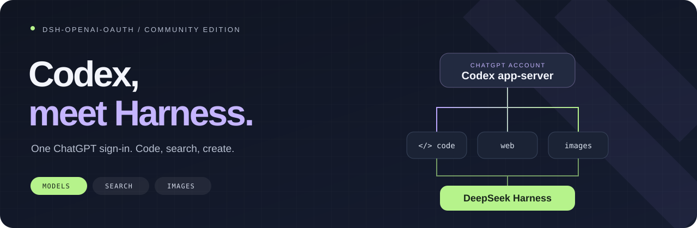

<div align="center">

# Codex inside DeepSeek Harness

**Code, search, and create with your ChatGPT account.**<br>
Your conversations, tools, and permissions stay in Harness.

[](https://github.com/X1mper/dsh-openai-oauth/releases/tag/v0.8.1) [](#compatibility) [](#compatibility) [](LICENSE)

**English** · [Русский](README.ru.md) · [简体中文](README.zh-CN.md)

[Quick start](#start) · [Web & images](#tools) · [Technical guide](guides/REFERENCE.md) · [Release notes](https://github.com/X1mper/dsh-openai-oauth/releases/tag/v0.8.1)

**0.8.1:** Adds optional `thresholdTokens` for Codex pressure compaction and fixes idle-policy access to isolated compaction services. For isolated backends, move the policy into the compaction group and disable the root instance; see the [migration guide](guides/NATIVE-PROVIDER.md). Restart Harness after upgrading. Defaults stay unchanged unless configured.

**0.8.0:** Pressure compaction retains overhead across pruning and replacement, avoiding repeated compression of a checkpoint plus tiny messages. Idle compaction retries eligible steps after route skips; active turn time does not count as idle. After 30 minutes, idle is checked on the next continuation, not by a background timer. Restart Harness after upgrading.

**0.7.0 unifies quota and context in one Codex button, fixes conflicting permission metadata and native MCP tool-name collisions, and disables native multi-agent v2. Harness still enforces tool permissions; no host patch is required.** See the [compatibility and activation guide](guides/context-usage-compat.md).

</div>

[Native provider, independent components and idle compaction](guides/NATIVE-PROVIDER.md).

**Restart Harness after upgrading from 0.5.x** so the old monolithic plugin releases its registrations before the new components start.

---

## Optional absolute compaction cap

The `dsh-openai-oauth/compaction` component accepts optional `thresholdTokens`
(for example `200000`), a positive safe integer. For Codex pressure compaction
it caps the existing ratio/headroom threshold, never raises it. Omit it to keep
existing behavior. Configure `retainTokens` or `retainRatio` so the retained tail
is strictly below the effective threshold; invalid budgets are rejected.
This top-level option does not change other providers, manual/overflow compaction,
or pricing, and is not accepted in `modelPolicies`.

Merge these fields into the existing `compaction-basic` entry in your profile
patch; preserve its other configuration and do not replace the whole profile:

```yaml
- id: compaction-basic
  name: dsh-openai-oauth/compaction
  config:
    thresholdTokens: 200000
    retainTokens: 32000
```

The effective safe threshold can still be lower than `200000`. Retention is not
automatically clamped: a retained tail at or above that threshold is rejected.

## A little more room to build

`dsh-openai-oauth` connects Harness to the official local **Codex app-server**. Sign in with ChatGPT, pick a model, and keep working in the Harness interface you already use. No OpenAI API key required.

| | What you get |
| :-- | :-- |
| 🧠 **Codex models** | A live model catalog, ChatGPT sign-in, and token refresh handled by Codex. |
| 🔎 **The web, built in** | Native search and page reading through the usual Harness tools, with source links. |
| 🎨 **Images, both ways** | Read attachments and MCP screenshots. Generate new images or edit up to four references. |
| 🧵 **Conversations that carry on** | Resume matching completed threads; deliver incoming instructions without repeatedly rebuilding the conversation. |
| 📊 **Usage you can see** | Actual token counts and provider-reported ChatGPT quota windows in the UI. |
| 🛠️ **Your Harness tools** | Harness keeps control of tool execution, file permissions, and approvals. |

<a id="start"></a>

## Up and running

### 1 · Install

```sh
dsh plugin --profile web add github:X1mper/dsh-openai-oauth#v0.8.1
```

Restart Harness after installation. Prefer an archive? Grab the compiled `.tgz` from the [release page](https://github.com/X1mper/dsh-openai-oauth/releases/tag/v0.8.1).

<details>
<summary>No <code>dsh</code> command, or using headless?</summary>

Use your installed Harness launcher. For example:

```sh
npx @deepseek-ai/dsh plugin --profile web add github:X1mper/dsh-openai-oauth#v0.8.1
```

Replace `web` with `headless` for that profile. Profiles install their dependencies separately. If your installer does not register the bundle, add `dsh-openai-oauth` to the profile's existing `dsh.profile.bundles` list.

The upstream `npx dsh-openai-oauth install` command installs the upstream npm package, not this fork. Use the GitHub reference above.

</details>

### 2 · Sign in

Open **Settings → OpenAI · Codex → Sign in with ChatGPT** and finish authorization on the OpenAI page.

### 3 · Pick a model

Select **OpenAI Codex (ChatGPT OAuth)** in the Harness model picker, then choose a model available to your account. The catalog comes from Codex; it is not hardcoded here.

<details>
<summary>Headless sign-in and first run</summary>

```sh
npx @deepseek-ai/dsh plugin --profile headless exec dsh-codex-login
npx @deepseek-ai/dsh --profile headless "inspect this repository"
```

Choose your provider/model in the profile configuration. [Configuration example →](guides/REFERENCE.md#select-a-model)

</details>

<a id="tools"></a>

## Give it something to do

### 🔎 Find it. Open it. Follow the sources.

> Find the official docs for this library, open the relevant page, and explain what changed.

Use Codex search and ordinary HTTP page reading in `~/.dsh/profiles/web/cordis.patch.yml`:

```yaml
- id: web
  config:
    searchProvider: openai-codex
    fetchProvider: http
- id: codex-web-fetch
  disabled: true
- id: tool-web
  config:
    searchTimeoutMs: 120000
    fetchTimeoutMs: 120000
```

Apply the same patch to `headless` if you use it. Explicit provider selection also avoids the “multiple usable web providers” error. Search and image generation are shared across model providers. Codex page reading is an optional global opt-in: enable `codex-web-fetch` and select `fetchProvider: openai-codex`; it is not scoped to the active model route. No DeepSeek API key is needed for these Codex-backed tools.

### 🎨 Start from a sentence. Or a picture.

> Create a square avatar: a tiny astronaut tending a plant on the moon.

> Keep the character from this image, change the background to a rainy city, and preserve the composition.

The model uses `image_generate` for a new image and `image_edit` for references already attached to the conversation. For a local file, use `read_image` first. Results become new PNG attachments; originals stay intact.

The result includes a verified file path so the model can show the image in its final answer and attach a file card with `present` when available. No separate imagegen skill or API-key setup is needed.

<a id="compatibility"></a>

## The small print, kept small

- **Tested with:** Harness `0.2.1-rc.5`, Node.js `22.19+`; bundled Codex is pinned to `0.166.0`.
- **Account access:** requires a ChatGPT account with Codex access. Available models, image generation, and quotas depend on your account.
- **Page reading:** Codex returns extracted text, not raw HTML. HTTP status `0` means unknown. Use `fetchProvider: http` for ordinary HTTP retrieval.
- **Context:** the Codex-only indicator separates occupancy from billing. Plugin compaction requires replacing the existing backend as described in the [compatibility guide](guides/context-usage-compat.md); installation alone does not activate it. `/compact` still uses Harness summaries; recovery is not lossless replay.
- **Sign-in:** credentials live separately in `~/.deepseek-harness/codex` and are managed by Codex. Another Codex installation's login is not copied.

## Under the hood

```text
Harness conversation & tools
          │
     dsh-openai-oauth
          │
   local Codex app-server
          │
     ChatGPT account
```

Automated tests cover billing, compaction, and route isolation.

[Configuration, permissions & recovery](guides/REFERENCE.md) · [Development & checks](guides/REFERENCE.md#development) · [Uninstall](guides/REFERENCE.md#uninstall)

## Roots & credits

Built on [DGPisces/dsh-openai-oauth](https://github.com/DGPisces/dsh-openai-oauth). This fork maintains compatibility with current Harness and adds the integrations above. Original commits from [upstream PR #3](https://github.com/DGPisces/dsh-openai-oauth/pull/3) retain their authorship.

Independent community project; not an official OpenAI or DeepSeek product. [MIT licensed](LICENSE).
