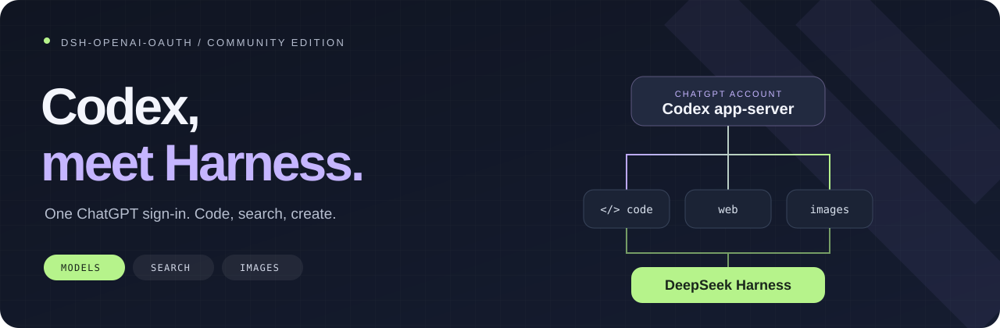

<div align="center">

# Codex внутри DeepSeek Harness

**Пиши код, исследуй и рисуй через свой аккаунт ChatGPT.**<br>
Диалоги, инструменты и разрешения остаются в Harness.

[](https://github.com/X1mper/dsh-openai-oauth/releases/tag/v0.7.0) [](#compatibility) [](#compatibility) [](LICENSE)

[English](README.md) · **Русский** · [简体中文](README.zh-CN.md)

[Быстрый старт](#start) · [Веб и картинки](#tools) · [Техническая справка](guides/REFERENCE.ru.md) · [Что в релизе](https://github.com/X1mper/dsh-openai-oauth/releases/tag/v0.7.0)

**0.7.0 объединяет квоты и контекст под одной кнопкой Codex, исправляет противоречивые сведения о правах и конфликты имён MCP-инструментов, отключает нативный multi-agent v2. Права инструментов проверяет Harness; патч ядра не нужен.** См. [руководство по совместимости и активации](guides/context-usage-compat.md).

</div>

[Нативный провайдер, независимые компоненты и компакт после простоя](guides/NATIVE-PROVIDER.md).

**После обновления с 0.5.x перезапусти Harness:** старый монолитный плагин должен освободить регистрации перед запуском отдельных компонентов.

---

## Больше возможностей для твоих идей

`dsh-openai-oauth` соединяет Harness с официальным локальным **Codex app-server**. Войди через ChatGPT, выбери модель и продолжай работу в привычном интерфейсе Harness. Ключ OpenAI API не нужен.

| | Что получаешь |
| :-- | :-- |
| 🧠 **Модели Codex** | Актуальный каталог моделей, вход через ChatGPT и обновление токенов силами Codex. |
| 🔎 **Веб под рукой** | Нативный поиск и чтение страниц через обычные инструменты Harness, со ссылками на источники. |
| 🎨 **Картинки в обе стороны** | Чтение вложений и MCP-скриншотов, генерация и редактирование по 1–4 референсам. |
| 🧵 **Диалог продолжается** | Восстановление совпадающих завершённых thread и новые указания без повторного пересоздания всего диалога. |
| 📊 **Расход на виду** | Реальные счётчики токенов и окна квот ChatGPT в интерфейсе. |
| 🛠️ **Твои инструменты Harness** | Выполнение команд, доступ к файлам и подтверждения контролирует Harness. |

<a id="start"></a>

## Поехали

### 1 · Установи

```sh
dsh plugin --profile web add github:X1mper/dsh-openai-oauth#v0.7.0
```

После установки перезапусти Harness. Нужен архив? Готовый `.tgz` лежит на [странице релиза](https://github.com/X1mper/dsh-openai-oauth/releases/tag/v0.7.0).

<details>
<summary>Нет команды <code>dsh</code> или нужен headless?</summary>

Используй свой launcher Harness. Например:

```sh
npx @deepseek-ai/dsh plugin --profile web add github:X1mper/dsh-openai-oauth#v0.7.0
```

Для профиля без веб-интерфейса замени `web` на `headless`. У каждого профиля свои зависимости. Если установщик не зарегистрировал bundle автоматически, добавь `dsh-openai-oauth` в существующий список `dsh.profile.bundles` этого профиля.

Команда `npx dsh-openai-oauth install` устанавливает upstream npm-пакет, а не этот форк. Используй GitHub-ссылку из примера выше.

</details>

### 2 · Войди через ChatGPT

Открой **Settings → OpenAI · Codex → Sign in with ChatGPT** и заверши авторизацию на странице OpenAI.

### 3 · Выбери модель

В списке моделей Harness выбери **OpenAI Codex (ChatGPT OAuth)** и доступную твоему аккаунту модель. Каталог приходит из Codex, а не зашит в плагин.

<details>
<summary>Вход и первый запуск в headless</summary>

```sh
npx @deepseek-ai/dsh plugin --profile headless exec dsh-codex-login
npx @deepseek-ai/dsh --profile headless "изучи этот репозиторий"
```

Провайдер и модель выбираются в настройках профиля. [Пример конфигурации →](guides/REFERENCE.ru.md#выбор-модели)

</details>

<a id="tools"></a>

## Дай ему задачу

### 🔎 Найти, открыть, разобраться

> Найди официальную документацию этой библиотеки, открой нужную страницу и объясни, что изменилось.

Настрой поиск через Codex и обычное HTTP-чтение страниц в `~/.dsh/profiles/web/cordis.patch.yml`:

```yaml
- id: web
  config:
    searchProvider: openai-codex
    fetchProvider: http
- id: codex-web-fetch
  disabled: true
- id: tool-web
  config:
    searchTimeoutMs: 120000
    fetchTimeoutMs: 120000
```

Если пользуешься `headless`, добавь настройки и в его patch. Явный выбор провайдеров также устраняет ошибку «multiple usable web providers». Поиск и генерация изображений доступны независимо от провайдера модели. Чтение страниц через Codex включается отдельно и глобально: включи `codex-web-fetch` и выбери `fetchProvider: openai-codex`; оно не ограничено активным маршрутом модели. Для этих инструментов Codex ключ DeepSeek API не нужен.

### 🎨 Начни с фразы. Или с картинки.

> Нарисуй квадратный аватар: маленький космонавт выращивает растение на Луне.

> Сохрани персонажа с этой картинки, замени фон на дождливый город и оставь композицию.

Для новой картинки модель вызывает `image_generate`, для работы по вложенным референсам — `image_edit`. Локальный файл сначала читается через `read_image`. Результат сохраняется новым PNG-вложением; оригинал остаётся на месте.

В ответе инструмента есть проверенный путь: модель может сразу показать картинку в итоговом сообщении и приложить карточку файла через `present`, если он доступен. Отдельный навык imagegen и настройка API-ключа не нужны.

<a id="compatibility"></a>

## Полезно знать

- **Проверено с:** Harness `0.2.1-rc.5`, Node.js `22.19+`; встроенный Codex закреплён на `0.166.0`.
- **Доступ:** нужен аккаунт ChatGPT с Codex. Доступные модели, генерация картинок и квоты зависят от аккаунта.
- **Чтение страниц:** Codex возвращает извлечённый текст, не исходный HTML. HTTP `0` означает неизвестный код. Для обычного HTTP-запроса можно выбрать `fetchProvider: http`.
- **Контекст:** индикатор только для Codex отделяет заполнение контекста от биллинга. Для сжатия через плагин нужно заменить существующий backend по [руководству совместимости](guides/context-usage-compat.md); одна установка его не активирует. `/compact` по-прежнему использует резюме Harness; восстановление не является побайтовым replay.
- **Авторизация:** Codex хранит её отдельно в `~/.deepseek-harness/codex`. Вход из другой установки Codex не копируется.

## Под капотом

```text
Диалог и инструменты Harness
           │
      dsh-openai-oauth
           │
   локальный Codex app-server
           │
      аккаунт ChatGPT
```

Автоматические тесты покрывают биллинг, сжатие контекста и изоляцию маршрутов.

[Настройки, разрешения и восстановление](guides/REFERENCE.ru.md) · [Разработка и проверки](guides/REFERENCE.ru.md#разработка) · [Удаление](guides/REFERENCE.ru.md#удаление)

## Откуда всё выросло

Основано на [DGPisces/dsh-openai-oauth](https://github.com/DGPisces/dsh-openai-oauth). Этот форк поддерживает совместимость с текущим Harness и добавляет описанные выше возможности. Оригинальные коммиты из [upstream PR #3](https://github.com/DGPisces/dsh-openai-oauth/pull/3) сохранены с авторством.

Независимый проект сообщества, не официальный продукт OpenAI или DeepSeek. [Лицензия MIT](LICENSE).
