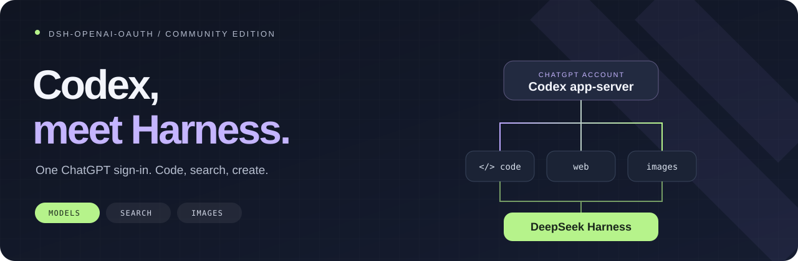

<div align="center">

# 在 DeepSeek Harness 中使用 Codex

**用你的 ChatGPT 账户，写代码、查资料、做创作。**<br>
对话、工具和权限仍由 Harness 管理。

[](https://github.com/X1mper/dsh-openai-oauth/releases/tag/v0.9.0-beta.1) [](#compatibility) [](#compatibility) [](LICENSE)

[English](README.md) · [Русский](README.ru.md) · **简体中文**

[快速开始](#start) · [网页与图片](#tools) · [技术参考](guides/REFERENCE.zh-CN.md) · [发行说明](https://github.com/X1mper/dsh-openai-oauth/releases/tag/v0.9.0-beta.1)

**Beta / 预发布：** 自动化测试通过；双真实账户及重启后的生产行为仍需验证。稳定用户请继续使用 0.8.2。

**0.9.0-beta.1 — 命名账户：** 在 Settings → OpenAI · Codex 添加“工作”和“个人”账户并分别登录。每个会话在模型选择器中选择 **Codex · 账户名称**，即可同时使用两个账户。原有登录和 `openai-codex` 路由保持不变；新账户具有独立目录、进程、线程和配额。搜索、网页读取与图片操作使用会话选择的账户，不会自动切换账户。原生压缩指示保持不变。

请在活动回合结束后升级，重启 Harness 并刷新页面；不要在回合中删除正在使用的提供方。账户元数据保存于 Codex 目录中的 `accounts.json`，额外凭据保存在 `accounts/<uuid>`，不会通过 UI/API 暴露。降级前请私密备份 Codex 目录；旧版本不支持新增路由。

**0.8.2：** 在 Settings → OpenAI · Codex 的上下文设置中加入压缩令牌上限。自动发现活动的策略和压缩后端（包括隔离组），不再依赖固定 ID。保存后的上限在后续压力检查中生效，无需重启；清空或重置会恢复 profile 值，不一定是自动模式。请在回合结束后升级包，重启一次 Harness 并刷新页面。

**0.8.1：** 新增可选的 `thresholdTokens`，限制 Codex 压力压缩阈值；修复空闲策略访问隔离压缩服务的问题。使用隔离后端时，请将策略移入 compaction 组并禁用根实例，参阅[迁移指南](guides/NATIVE-PROVIDER.md)。升级后重启 Harness；未配置时保留原有默认行为。[配置示例](README.md#optional-absolute-compaction-cap)。

**0.8.0：** 压力压缩在裁剪和替换过程中保留额外开销，避免反复压缩检查点和少量短消息。空闲压缩在路由跳过后会重试符合条件的步骤；活动回合时间不计入空闲。满 30 分钟后，在下一次继续对话时检查，而不是由后台计时器触发。升级后请重启 Harness。

**0.7.0 将配额与上下文合并到一个 Codex 按钮中，修复权限信息冲突和原生 MCP 工具名称冲突，并关闭原生 multi-agent v2。工具权限仍由 Harness 执行，无需修改宿主。** 请参阅[兼容性与启用指南](guides/context-usage-compat.md)。

</div>

[原生提供程序、独立组件与空闲压缩](guides/NATIVE-PROVIDER.md)。

**从 0.5.x 升级后请重启 Harness**，让旧版整体插件释放注册项，再启用独立组件。

---

## 给创作多一点空间

`dsh-openai-oauth` 将 Harness 连接到官方本地 **Codex app-server**。通过 ChatGPT 登录、选择模型，然后继续在熟悉的 Harness 界面中工作。无需 OpenAI API Key。

| | 你会获得 |
| :-- | :-- |
| 🧠 **Codex 模型** | 从 Codex 获取最新模型目录，由它处理 ChatGPT 登录和令牌刷新。 |
| 🔎 **内置网页能力** | 通过标准 Harness 工具进行原生搜索和页面读取，保留来源链接。 |
| 🎨 **看图，也能创作** | 读取附件和 MCP 截图，生成新图片，或根据 1–4 张参考图编辑。 |
| 🧵 **继续原来的对话** | 恢复匹配的已完成线程，接收新指令时无需反复重建整个对话。 |
| 📊 **看得见的用量** | 在界面中查看真实令牌统计和服务端报告的 ChatGPT 配额窗口。 |
| 🛠️ **保留 Harness 工具** | 工具执行、文件访问和审批继续由 Harness 控制。 |

<a id="start"></a>

## 开始使用

### 1 · 安装

```sh
dsh plugin --profile web add github:X1mper/dsh-openai-oauth#v0.8.2
```

安装后重启 Harness。需要压缩包？[发行页面](https://github.com/X1mper/dsh-openai-oauth/releases/tag/v0.9.0-beta.1)提供已编译的 `.tgz`。

<details>
<summary>没有 <code>dsh</code> 命令，或使用 headless？</summary>

使用你已安装的 Harness 启动器。例如：

```sh
npx @deepseek-ai/dsh plugin --profile web add github:X1mper/dsh-openai-oauth#v0.8.2
```

无界面使用时将 `web` 替换为 `headless`。各 profile 独立安装依赖。如果安装器未自动注册 bundle，请将 `dsh-openai-oauth` 加入该 profile 现有的 `dsh.profile.bundles` 列表。

上游的 `npx dsh-openai-oauth install` 安装的是上游 npm 包，不是这个分支。请使用上面的 GitHub 引用。

</details>

### 2 · 使用 ChatGPT 登录

打开 **Settings → OpenAI · Codex → Sign in with ChatGPT**，在 OpenAI 页面完成授权。

### 3 · 选择模型

在 Harness 模型选择器中选择 **OpenAI Codex (ChatGPT OAuth)**，再选择你的账户可用的模型。模型目录来自 Codex，而非插件内的固定列表。

<details>
<summary>Headless 登录与首次运行</summary>

```sh
npx @deepseek-ai/dsh plugin --profile headless exec dsh-codex-login
npx @deepseek-ai/dsh --profile headless "分析这个代码仓库"
```

在 profile 配置中选择提供方和模型。[配置示例 →](guides/REFERENCE.zh-CN.md#选择模型)

</details>

<a id="tools"></a>

## 交给它一个任务

### 🔎 找到资料，打开页面，查看来源

> 找到这个库的官方文档，打开相关页面，解释发生了哪些变化。

在 `~/.dsh/profiles/web/cordis.patch.yml` 中配置 Codex 搜索和普通 HTTP 页面读取：

```yaml
- id: web
  config:
    searchProvider: openai-codex
    fetchProvider: http
- id: codex-web-fetch
  disabled: true
- id: tool-web
  config:
    searchTimeoutMs: 120000
    fetchTimeoutMs: 120000
```

如果使用 `headless`，也在它的 patch 中添加这些配置。明确选择提供方可避免 “multiple usable web providers” 错误。搜索和图片生成可跨模型提供方共享。Codex 页面读取是可选的全局功能：启用 `codex-web-fetch` 并选择 `fetchProvider: openai-codex`；它不按当前模型路由隔离。这些 Codex 工具无需 DeepSeek API Key。

### 🎨 从一句话，或一张图开始

> 画一个方形头像：小宇航员在月球上种植一株植物。

> 保留这张图中的角色，将背景改成雨中的城市，并保持构图。

模型通过 `image_generate` 生成图片，通过 `image_edit` 编辑会话中的参考图。本地文件先用 `read_image` 读取。结果保存为新的 PNG 附件，原图保持不变。

工具返回经过验证的文件路径，方便模型在最终回复中直接展示图片，并在 `present` 可用时添加文件卡片。无需额外 imagegen 技能或 API Key 配置。

<a id="compatibility"></a>

## 使用前了解这些

- **验证环境：** Harness `0.2.1-rc.5`、Node.js `22.19+`；内置 Codex 固定为 `0.166.0`。
- **账户访问：** 需要拥有 Codex 权限的 ChatGPT 账户。模型、图片生成能力和配额取决于账户。
- **页面读取：** 返回提取的文字，不是原始 HTML。HTTP `0` 表示状态码未知。普通 HTTP 获取可使用 `fetchProvider: http`。
- **上下文：** 仅用于 Codex 的指示器区分上下文占用与计费用量。插件压缩需要按[兼容性指南](guides/context-usage-compat.md)替换现有后端；仅安装插件不会自动启用。`/compact` 仍使用 Harness 摘要；恢复不是无损重放。
- **登录信息：** 由 Codex 独立管理，保存在 `~/.deepseek-harness/codex`，不会复制另一套 Codex 安装的登录状态。

## 工作原理

```text
Harness 对话与工具
        │
   dsh-openai-oauth
        │
 本地 Codex app-server
        │
   ChatGPT 账户
```

自动测试覆盖计费、上下文压缩和路由隔离。

[配置、权限与恢复](guides/REFERENCE.zh-CN.md) · [开发与检查](guides/REFERENCE.zh-CN.md#本地开发) · [卸载](guides/REFERENCE.zh-CN.md#卸载)

## 来源与致谢

基于 [DGPisces/dsh-openai-oauth](https://github.com/DGPisces/dsh-openai-oauth)。本分支持续适配当前 Harness，并添加上述集成功能。[上游 PR #3](https://github.com/DGPisces/dsh-openai-oauth/pull/3) 中的原始提交保留作者信息。

独立社区项目，并非 OpenAI 或 DeepSeek 官方产品。[MIT 许可证](LICENSE)。
